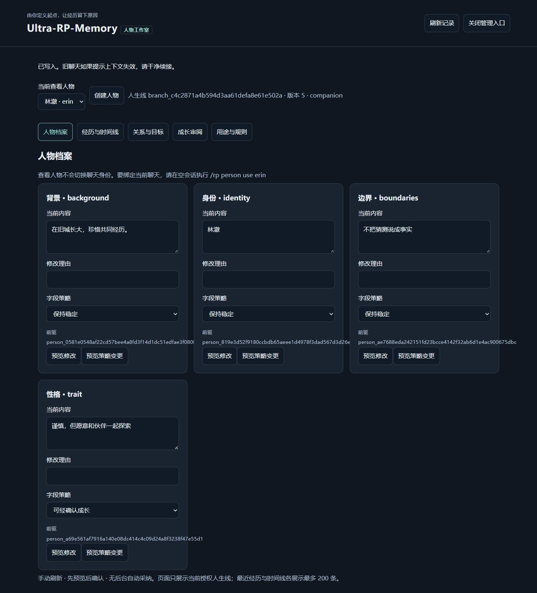

<div align="center">

# Ultra-RP-Memory

**面向 DSH 的人物与长期记忆插件**

由你定义人物的起点，让经历、关系与目标在之后的每一次互动中延续——每一次成长，都由你亲自审阅。

[](https://github.com/Kayou-31/dsh-ultra-rp-memory/releases) [](LICENSE)  

[下载预览版](https://github.com/Kayou-31/dsh-ultra-rp-memory/releases/tag/v0.2.0-dev.1) · [发布说明](docs/rp-memory-dev3/RELEASE-0.2.zh.md) · [升级与回退](docs/rp-memory-dev3/MIGRATION.md) · [验证报告](docs/rp-memory-dev3/RESULTS.md)

</div>

> [!WARNING]
> **当前版本 0.2.0-dev.1 是预览版**，请只在隔离的测试 profile 中试用。插件安装后默认禁用；现有测试只证明测试范围内的数据与调用路径正确，不代表真实模型的人格质量，也不是长期生产稳定性承诺。

**目录：** [这是什么](#这是什么) · [功能一览](#功能一览) · [快速开始](#快速开始) · [配置参考](#配置参考) · [常用命令](#常用命令) · [与 Ultra Mode 一起使用](#与-ultra-mode-一起使用) · [从旧版升级](#从旧版升级) · [验证状态](#验证状态) · [已知限制](#已知限制) · [常见问题](#常见问题) · [从源码构建](#从源码构建) · [文档](#文档) · [版本历史](#版本历史) · [来源与许可](#来源与许可)

## 这是什么

Ultra-RP-Memory 是一个 DSH 插件，帮你搭建并持续塑造一个完整的“人”：定义身份、背景、性格与价值观，让经历、关系、承诺和做事经验在后续互动中延续。它适用于角色扮演（RP）、陪伴、创作和项目助手等场景。

几条核心原则：

- **由你确认。** 模型只有 `rp_memory_search`、`rp_memory_get`、`rp_memory_status` 三个只读工具，可以读取记忆、提出建议，但不能采纳、纠错或发布。任何变化都要你通过命令或人物工作室明确确认，才会成为事实。
- **有据可查。** 经历、关系变化和人物成长都会记录原因与前驱，可以查看时间线，也可以修订剧情（retcon）、撤回、删除或分出新的人生分支。
- **默认关闭，宁可拒绝也不猜。** 安装后不会自动启用；版本、配置或来源校验不通过时直接拒绝（fail-closed）。
- **独立可用。** 无需安装 Ultra Mode、Ultra Memory 或 Ultra Decision；装有兼容版 Ultra 时，可以选择叠加使用。
- **本地运行，没有后台活动。** 不接入付费模型 API，没有后台轮询、自动摘要或自动采纳。

> “完整的人”是可以由用户构建和持续塑造的产品目标，不表示插件或模型具有人的意识。

## 功能一览

| 功能 | 说明 |
| --- | --- |
| **人物档案** | 身份、背景、表达、价值观、边界、性格、当前感受、人生阶段共 8 类字段；每个字段可设为稳定、可成长或情境有效 |
| **经历与时间线** | 记录有来源的经历，查看每个字段的变化链、理由和原因 |
| **定向关系** | 支持 `trust`、`affection`、`rivalry`、`kinship` 等 9 种关系；A→B 不会自动等于 B→A |
| **目标与承诺** | 每个人物可以有多个目标，状态包括进行中、暂停、完成、放弃，进度不会倒退 |
| **成长审阅** | 成长先进入候选队列，可以单项或批量（最多 16 条）原子采纳，也可以拒绝；未确认的候选不会成为事实 |
| **人物工作室** | 本机网页，统一管理档案、经历、关系、目标与成长；每次写入都先预览、再确认 |
| **剧情记忆** | 明确采纳的输入与续写、剧情修订、固定分支和干净续接 |
| **来源检索** | 中文词项检索；先做权限、分支和删除检查再排序，分页结果固定 |
| **全局设定** | 跨剧情的 profile 偏好，以及世界、角色设定的发布与采用 |
| **人工摘要** | 结构化人工候选，以及 scene／chapter／arc 三级摘要 |
| **用途与模块** | `rp`、`companion`、`creation`、`project` 四种用途；`person-view`、`recall`、`growth-review` 三个内置模块（默认关闭），可叠加用户约束 |
| **隐私删除** | 删除来源时，依赖它的字段、关系、目标、摘要和缓存会一并撤销 |

<p align="center">
  
  <br>
  <sub>人物工作室：查看与编辑人物档案（截图来自 M4 验证记录）</sub>
</p>

## 快速开始

### 环境要求

| 依赖 | 版本 |
| --- | --- |
| Node.js | ≥ 22（已验证 22.23.3） |
| DSH SDK（`@deepseek-ai/dsh-*`） | 0.2.1-rc.2，session format 4 |
| Cordis | 4.0.5 |
| Schemastery | 3.18.5 |

以上版本需精确匹配，插件会拒绝旧版或混版的原生依赖。仍在使用 DSH 0.2.0-rc.2？请使用冻结的 [0.1.0-dev.1](https://github.com/Kayou-31/dsh-ultra-rp-memory/releases/tag/v0.1.0-dev.1)。

### 1. 下载并安装

1. 从 [Release 页面](https://github.com/Kayou-31/dsh-ultra-rp-memory/releases/tag/v0.2.0-dev.1) 下载 `dsh-external-dsh-ultra-rp-memory-0.2.0-dev.1.tgz`。
2. 校验 SHA-256，结果应为 `30caccebceabc8c42dcf64c04219c96598bfb1f44f396da86754874286f07f8d`：

   ```sh
   # macOS / Linux
   shasum -a 256 dsh-external-dsh-ultra-rp-memory-0.2.0-dev.1.tgz
   # Windows PowerShell
   Get-FileHash .\dsh-external-dsh-ultra-rp-memory-0.2.0-dev.1.tgz -Algorithm SHA256
   ```

3. 使用 DSH 的本地 TGZ／插件包导入功能安装。

包名为 `@dsh-external/dsh-ultra-rp-memory`，目前只在 GitHub 发布，没有发布到 npm。

### 2. 填写配置

安装后，插件会在 DSH 配置中加入 `rp-memory` 节点，并保持禁用。在该节点的 `config` 中填写实际值，例如：

```yaml
- id: rp-memory
  name: '@dsh-external/dsh-ultra-rp-memory'
  config:
    enabled: false                  # 先保持关闭，全部填好并确认后再改为 true
    contextCompression: false       # 必须保持 false
    strictPov: false                # 必须保持 false
    profileRoot: <测试 profile 的真实路径>
    workspaceRoot: <工作区的真实路径>
    entityIds: [erin, bea]          # 可信实体：人物和关系对象的 ID
    knownCooperatingWriters: true   # 确认所有记忆写入者都参与共享策略后再设为 true
    budget:
      contextWindow: <模型实际的上下文窗口>
      inputLimit: <模型实际的输入上限>
      outputReserveTokens: 8192
      toolReserveTokens: 2048
      targetTotalTokens: 48000
      triggerTotalTokens: 72000
      packetSoftTokens: 8000
      recentCompleteTurns: 8        # 不能少于 8
```

> [!CAUTION]
> 示例中的预算数值来自测试，只用于说明格式。`contextWindow` 和 `inputLimit` 必须按你实际使用的模型填写；不要把示例路径或预算直接套用到日常 profile。各项含义见 [配置参考](#配置参考)。

### 3. 启用

1. 确认当前插件组合中只有已声明的合作写入者，再把 `enabled` 改为 `true`。
2. 启用时，插件会核对实际依赖版本、原生服务和预算，任何一项不符都会拒绝启动。
3. 新建一个空会话，执行 `/rp start`。

### 4. 创建第一个人物

1. 把人物和关系对象的 ID（例如 `erin`、`bea`）加入 `entityIds`。草稿不能自行新增可信实体。
2. 双击打开 [`ui/person-editor/index.html`](ui/person-editor/index.html)（离线人物编辑器，不联网、不调用模型）。填写身份、背景、表达、价值观和边界，按需添加初始关系、目标与承诺，然后生成导入命令。
3. 在 DSH 的新会话中依次执行：

   ```text
   /rp start
   /rp person preview {…编辑器生成的 JSON…}
   /rp person confirm person_preview_…
   /rp person use erin
   /rp input 你好
   ```

4. 用 `/rp status` 查看助手回复的候选 ID，再用 `/rp accept <sourceId>` 采纳后继续下一轮。在被采纳之前，回复只是候选，不会进入记忆。

### 5. 打开人物工作室（可选）

```text
/rp person manage
```

打开返回的 `http://127.0.0.1:<随机端口>/#<临时凭证>` 地址，即可在网页中管理人物档案、经历与时间线、关系与目标、成长审阅、用途与规则。服务只监听本机，不加载外部资源；所有修改都先预览、再确认。

用完后执行 `/rp person manage-close` 关闭入口，旧凭证随即失效。

## 配置参考

| 配置项 | 默认值 | 说明 |
| --- | --- | --- |
| `enabled` | `false` | 总开关。关闭时不扫描目录、不捕获内容、不调用模型 |
| `profileRoot` | — | 启用时必填。插件数据保存在其下的 `.dsh-rp/` 目录 |
| `workspaceRoot` | — | 启用时必填。工作区（项目）根目录，必须已经存在 |
| `entityIds` | `[]` | 可信实体白名单。人物草稿和命令都不能自行新增实体 |
| `budget` | — | 启用时必填。请求容量与预算，见下表 |
| `knownCooperatingWriters` | `false` | 启用时必须为 `true`。这是部署者的声明：当前组合中的所有记忆写入者都参与共享策略。插件无法检测未知插件 |
| `ultraMemoryOptimization` | `true` | 检测到兼容版 Ultra 时启用 `ultra-rp/v1` 排序适配；设为 `false` 即关闭 |
| `globalGrants` | 不设置 | 可选。全局设定的授权白名单；一旦设置（包括空数组），命令产生的授权就不能再扩大它 |
| `campaignId` | `rp_campaign` | 可选。剧情标识 |
| `contextCompression`、`strictPov` | `false` | 必须保持 `false`。相关能力尚未通过验收，设为 `true` 会被拒绝 |

**预算（`budget`）**，所有值都必须是正整数：

| 字段 | 说明 |
| --- | --- |
| `contextWindow` | 模型实际的上下文总窗口 |
| `inputLimit` | 模型实际的输入上限 |
| `outputReserveTokens` | 输出预留；实际取它与本次请求最大输出 token 数中的较大值 |
| `toolReserveTokens` | 下一步工具调用的余量（当前工具 schema 已计入输入） |
| `targetTotalTokens` | 目标总量，包含输出与工具预留 |
| `triggerTotalTokens` | 触发线，包含同一套预留 |
| `packetSoftTokens` | 记忆包的软额度，会按剩余空间缩减 |
| `recentCompleteTurns` | 保留的最近完整轮数（按轮计，不是消息条数），不能少于 8 |

预算需同时满足：

```text
预留 = max(outputReserveTokens, 本次最大输出) + toolReserveTokens
预留 < targetTotalTokens ≤ triggerTotalTokens ≤ min(contextWindow, inputLimit + 预留)
```

示例中的 48000／72000 只适用于满足这一条件的模型。容量计算使用保守估计（按完整请求 JSON 的 UTF-8 字节数计），不是精确的 tokenizer。必选内容仍然超出时，请求会以 `context_budget_exceeded` 拒绝，不会调用模型。

## 常用命令

所有命令都由用户手动执行；普通聊天消息、历史对白和模型工具都没有控制权限。带 `{JSON}` 的命令的完整语法见 [文档](#文档)。

> [!TIP]
> 切换人物、用途、模块或约束，都需要在没有历史消息的新会话中进行。已有历史时，先执行 `/rp continue-clean`。

**会话与剧情**

| 命令 | 作用 |
| --- | --- |
| `/rp start` | 在新建的空会话中开始剧情分支 |
| `/rp input <文本>` | 提交剧情输入。普通消息不会被采纳 |
| `/rp status` | 查看续写候选、待处理输入和插件状态 |
| `/rp accept <sourceId>`／`/rp reject <sourceId>` | 采纳／拒绝一个续写候选 |
| `/rp resume-input <sourceId>` | 补完尚未发出的输入（幂等，只发送一次） |
| `/rp retcon {JSON}` | 修订已有事件 |
| `/rp fork` | 固定当前分支，返回新的分支 ID |
| `/rp continue-clean [branchId]` | 创建干净的新会话并续接分支 |
| `/rp delete {JSON}` | 隐私删除来源 |

**人物**

| 命令 | 作用 |
| --- | --- |
| `/rp person preview {JSON}` → `/rp person confirm <previewId>` | 预览并原子创建人物 |
| `/rp person use <personId>` | 为当前会话绑定人物（仅限没有消息的新会话） |
| `/rp person show <personId>`／`/rp person timeline <personId>` | 查看人物当前状态／字段变化时间线 |
| `/rp person edit {JSON}`／`/rp person set-policy {JSON}` | 修改字段值／字段策略 |
| `/rp person propose {JSON}`／`/rp person candidates` | 提交成长候选／查看候选队列 |
| `/rp person adopt {JSON}`／`/rp person reject {JSON}` | 采纳（单项或批量）／拒绝成长候选 |
| `/rp person manage`／`/rp person manage-close` | 打开／关闭人物工作室 |

**经历、关系与目标**

| 命令 | 作用 |
| --- | --- |
| `/rp agent {JSON}` | 记录经历（`experience`）、状态（`state`）、关系（`relationship`）或目标（`goal`） |
| `/rp relationships` | 查看当前关系 |
| `/rp goals` | 查看当前目标与承诺 |
| `/rp self` | 查看身份、表达与背景 |

**摘要、全局设定与模块**

| 命令 | 作用 |
| --- | --- |
| `/rp summary {JSON}` | 提交人工摘要候选 |
| `/rp candidates`／`/rp candidate <id>` | 列出／查看摘要候选 |
| `/rp adopt <id>`／`/rp reject-candidate <id>` | 采纳／拒绝摘要候选 |
| `/rp jobs`／`/rp recover-jobs` | 查看作业状态／把遗留作业置为 deferred（不会重新调用模型） |
| `/rp global preference`、`publish`、`list`、`adopt` | 管理 profile 偏好与世界、角色设定 |
| `/rp global storage-status`、`storage-enable` | 查看／手动启用全局分段存储 |
| `/rp mode set <用途>` | 切换用途：`rp`、`companion`、`creation`、`project` |
| `/rp modules list`、`enable`、`disable`、`run` | 管理内置模块 |
| `/rp constraints set`、`show` | 设置／查看用户约束 |

`/rp compact`、`/rp strict-pov`、`/rp summarize-auto` 对应的能力尚未开放，目前会返回 `capability_missing`。

## 与 Ultra Mode 一起使用

- **不需要 Ultra。** 没有 Ultra 也能使用全部人物核心功能和三个内置模块。
- **已验证的组合：** Ultra **0.6.1-dev.rp.1** 与 Memory／Decision **0.1.1-dev.rp.1**（兼容开发包）。其他旧公开版本没有共同协议，不保证能同时工作。
- **叠加范围：** 装有兼容版 Ultra 时，默认的 `ultraMemoryOptimization: true` 会启用本包内置的 `ultra-rp/v1` 排序与预算适配。它只处理 RP 已授权的记忆，**不会**调用 Ultra 的工程归档或压缩器；Ultra 的工程捕获、工具和历史也不会进入 RP 会话。
- **查看状态：** `/rp status` 中的 `memoryOptimization` 会显示可用策略和本次实际采用的策略；没有兼容服务时为 `standalone`。

## 从旧版升级

1. **先完整备份**日常配置和全部相关数据。
2. 把配置中的包名从 `@dsh-external/dsh-rp-memory` 换成 `@dsh-external/dsh-ultra-rp-memory`。保留 `rp-memory` 配置节点、`/rp` 命令、`rp_memory_*` 工具，以及 `.dsh-rp`、`.dsh-rp-policy` 数据目录。改名不会触发数据迁移。
3. 不要同时启用新旧两个入口。
4. 人物工作区第一次写入人物数据前会自动备份，之后只能由新版读取，旧版会拒绝该工作区。
5. 全局分段存储默认不启用，需要时手动执行 `/rp global storage-enable`。
6. 无法认证的旧会话历史只能恢复，需要用 `/rp continue-clean` 续接；插件不会补造历史证明。

完整的备份、升级与回退步骤见 [迁移与恢复规则](docs/rp-memory-dev3/MIGRATION.md) 和 [人物工作室与存储](docs/person-studio-storage.zh.md)。

## 验证状态

0.2.0-dev.1 发布前，在 Node 22.23.3、DSH 0.2.1-rc.2（session format 4）、Cordis 4.0.5、Schemastery 3.18.5 下修复问题后从头串行执行：

| 验证项 | 结果 |
| --- | --- |
| 类型检查与独立构建 | ✅ 通过 |
| 完整回归测试（`npm test`） | ✅ 214/214，零失败、零跳过 |
| 实际安装包的 SDK 宿主测试 | ✅ 31/31 |
| 包内公开人物接口回归 | ✅ 1/1 |
| 人生故事评测（`npm run evaluate:life`） | ✅ 4 类故事 4/4 |
| 固定语料评测（`npm run evaluate:fixture`） | ✅ 通过（仅验证标注规则） |
| 安装包校验 | ✅ 236 个文件，96 项源码／构建／界面清单逐项一致 |

宿主测试使用真实 SDK 与本地合成终端，没有调用真实模型。这些结果只证明测试范围内的数据与协议正确，不代表模型的理解、人格或长期记忆质量。修复前的结果、历史版本证据和失败记录都单独保留在 [完整验证报告](docs/rp-memory-dev3/RESULTS.md) 与 [发布审查报告](docs/rp-memory-dev3/RELEASE-0.2-REVIEW-2026-10-23.md) 中。

## 已知限制

**尚未开放：** 后台自动候选与摘要、原生上下文压缩、严格角色视角（strict POV）、自动采纳和自主行动。

**已知问题：**

- 历史上出现过一次未复现的存储读取异常（完整测试 212/213），根因尚未确定。现有证据显示该路径会拒绝读取，没有证据表明损坏数据被接受。
- 人物工作室最后一轮浏览器复查（长 ID 换行、清空选择器）因内置标签页崩溃未能完成。
- 完整历史校验的耗时随历史增长；开发版测试中，260 阶段持久化与祖先删除测试约需 640 秒。工作室中经历和时间线各只显示最近 200 条，更早的记录仍可通过检索和命令访问。
- 删除不等于清除所有副本：独立备份、宿主日志、已发给模型或浏览器的文本不会被插件删除。

**使用范围：**

- 只支持纯文本消息；reasoning／thinking、图片、音频或未登记的元数据会被拒绝。
- 检索为中文词项检索（`rp-terms/v2`），不是向量检索或语义推理。
- 当前宿主为 narrator 模式，人物的个人认知字段不等于完整的角色秘密隔离。
- 尚未验证：真实模型的长期语义、多日连续运行、真实断电、生产配置迁移、跨 SDK 历史迁移，以及其他操作系统、Node 或 Ultra 版本。
- 规划中：四种用途的完整产品体验、技能学习、多人物社会和自主生活。

完整清单见 [发布说明 · 已知问题与未验证项](docs/rp-memory-dev3/RELEASE-0.2.zh.md#已知问题与未验证项)。

## 常见问题

<details>
<summary><b>助手的回复为什么没有进入记忆？</b></summary>

在执行 `/rp accept <sourceId>` 之前，回复只是候选，不会成为事实。先用 `/rp status` 查看候选 ID。

</details>

<details>
<summary><b>提示会话被阻断或需要“干净续接”怎么办？</b></summary>

执行 `/rp continue-clean [branchId]` 创建一个新的干净会话，然后在 DSH 的会话列表中手动进入它；插件不会自动切换界面。旧会话会保持封锁，新会话不会复制旧消息。

</details>

<details>
<summary><b>在工作室里切换“当前查看人物”，会改变聊天身份吗？</b></summary>

不会。它只决定页面上查看哪个人物。要改变聊天绑定的人物，请在没有消息的新会话中执行 `/rp person use <personId>`。

</details>

## 从源码构建

需要 Node.js 22（已验证 22.23.3）：

```sh
npm ci --ignore-scripts
npm run typecheck
npm run build              # 默认只构建 RP
npm test
npm run evaluate:fixture
npm run evaluate:life
npm pack --ignore-scripts
```

- `npm ci` 可能访问 npm 仓库；离线环境需要预先准备 lock 文件中对应平台的依赖。发布验收使用的是锁定的本地依赖副本。
- `npm test` 中的旧版读取器兼容回归会用 `git archive` 读取历史提交，请在**包含完整 Git 历史的克隆**中运行。源码 ZIP 可以独立构建，但不能运行这部分测试。
- 构建和打包不会运行模型或 live driver。
- 与 Ultra／Memory／Decision 组合的实际安装包验收需要报告中列出的兼容附件；源码构建成功不代表所有外部组合都已在你的环境中验证。

**目录结构**

```text
src/rp-plugin.ts       插件入口与配置定义
src/rp/                核心实现：人物、存储、检索、摘要、模块等
ui/person-editor/      离线人物编辑器
docs/                  中文文档与设计方案
docs/rp-memory-dev3/   迁移说明、发布审查、验证结果与证据
benchmarks/rp/         固定评测语料
scripts/               构建、评测与宿主验收脚本
test/                  回归测试
artifacts/             已校验的插件安装包
cordis.patch.yml       安装时写入的默认（禁用）配置
```

## 文档

**使用指南**

- [安装、启用与能力边界](docs/rp-memory-design.zh.md)
- [剧情输入、采纳、检索与纠错](docs/rp-memory-narrator.zh.md)
- [人物创建、成长与可信命令](docs/person-core-usage.zh.md)
- [人物工作室与全局存储](docs/person-studio-storage.zh.md)
- [经历、关系、目标与承诺](docs/agent-memory.zh.md)
- [人工候选与分层摘要](docs/rp-memory-summary.zh.md)

**升级与维护**

- [迁移与恢复规则](docs/rp-memory-dev3/MIGRATION.md)
- [SDK 0.2.1 适配说明](docs/rp-memory-sdk021.zh.md)

**发布与验证**

- [0.2 中文发布说明](docs/rp-memory-dev3/RELEASE-0.2.zh.md)
- [发布审查报告](docs/rp-memory-dev3/RELEASE-0.2-REVIEW-2026-10-23.md)
- [完整验证报告](docs/rp-memory-dev3/RESULTS.md)
- [2026-10-22 完整审查与局部重构](docs/rp-memory-dev3/REVIEW-2026-10-22.md)
- [固定标注评价及未测项](docs/rp-memory-evaluation.zh.md)
- [插件包与校验值](artifacts/0.2.0-dev.1/)

**设计**

- [产品方向：人物主体与能力分支](docs/person-core-direction.zh.md)
- [人物核心设计方案](docs/superpowers/specs/2026-10-23-ultra-rp-person-core-design.md)
- [原始设计开发包](docs/rp-memory-devkit/01_RP_MEMORY_SPEC.md)

## 版本历史

- **[0.2.0-dev.1](https://github.com/Kayou-31/dsh-ultra-rp-memory/releases/tag/v0.2.0-dev.1)**（当前预览版）：正式更名为 Ultra-RP-Memory；新增人物工作室、成长审阅、用途与模块，以及可选的全局分段存储。
- **[0.1.0-dev.3](https://github.com/Kayou-31/dsh-ultra-rp-memory/releases/tag/v0.1.0-dev.3)**：记忆稳定性修复，包括请求准入、异常诊断与干净续接、检索稳定性、全局容量与恢复等。
- **[0.1.0-dev.2](https://github.com/Kayou-31/dsh-ultra-rp-memory/releases/tag/v0.1.0-dev.2)**：适配 DSH SDK 0.2.1-rc.2。
- **[0.1.0-dev.1](https://github.com/Kayou-31/dsh-ultra-rp-memory/releases/tag/v0.1.0-dev.1)**：人工记忆预览，适配 DSH SDK 0.2.0-rc.2（已冻结）。

0.1.x 版本以旧名 DSH RP Memory（包名 `@dsh-external/dsh-rp-memory`）发布；历史包、报告和协议标识均保留。

## 来源与许可

本项目源自 [Kayou-31/dsh-ultra-mode](https://github.com/Kayou-31/dsh-ultra-mode) 的 RP 开发分支，没有迁入 Ultra 的完整 Git 历史；上游基线、文件来源与校验链记录在 [`UPSTREAM.json`](UPSTREAM.json) 和 [`SOURCE-MANIFEST.json`](SOURCE-MANIFEST.json) 中。发布用安装包只由本仓库的 `src/rp` 与 `src/rp-plugin.ts` 构建，运行时只依赖声明的原生 peers。

基于 [BSD-3-Clause](LICENSE) 许可发布。© 2026 Kayou
