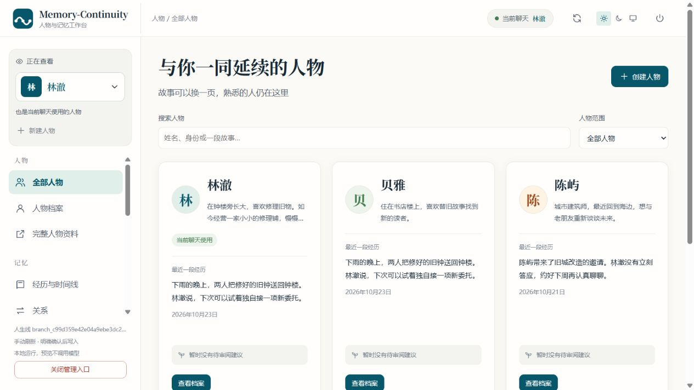
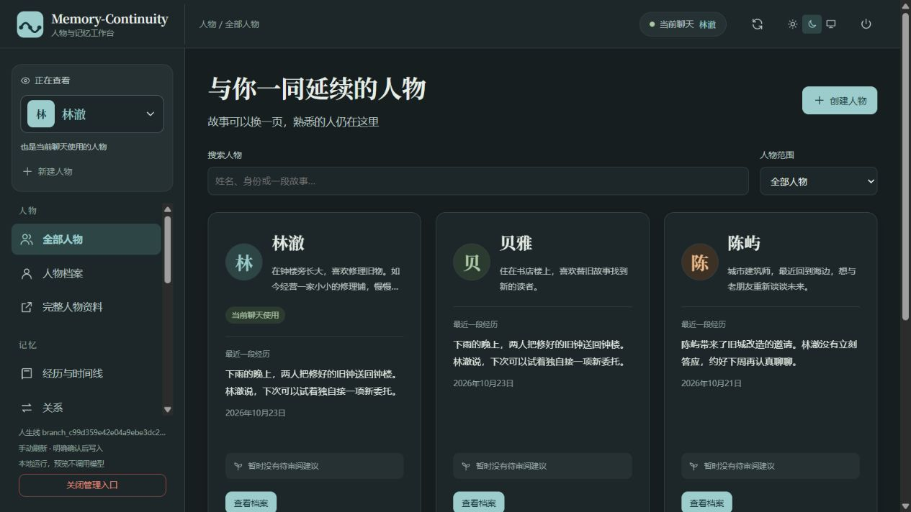
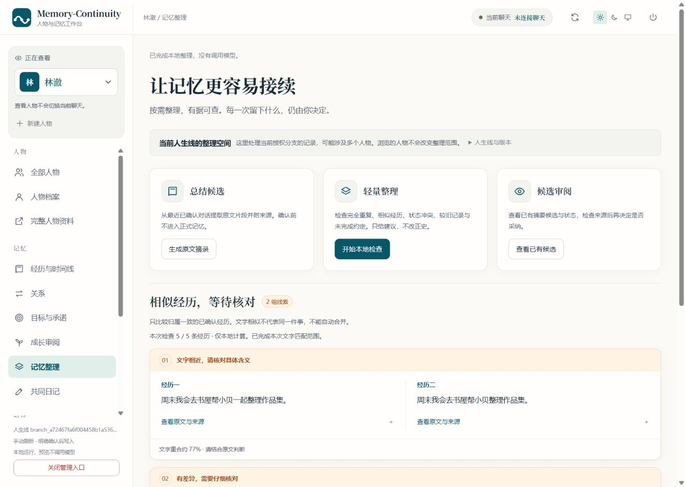

<div align="center">

# Memory-Continuity

**让会话可以结束，让你塑造的人物继续。**

人物连续性与长期记忆 · DSH 插件 / 独立核心 / AstrBot 管理桥<br>
放得下完整的人物资料，也留得住一起度过的一天。

[](https://github.com/Kayou-31/Memory-Continuity/releases/tag/v0.3.1)
[](package.json)
[](package.json)
[](LICENSE)

[下载正式版](https://github.com/Kayou-31/Memory-Continuity/releases/tag/v0.3.1) · [完整源码](https://github.com/Kayou-31/Memory-Continuity/releases/download/v0.3.1/Memory-Continuity-0.3.1-source.zip) · [这次更新了什么](docs/releases/0.3.1/RELEASE.zh.md) · [验证与限制](docs/releases/0.3.1/RESULTS.md)

</div>

**当前正式版：0.3.1。** 人物可以写得更完整，聊天里值得留下的片段也有了自己的审阅入口。长资料保留原文，AI 提出的经历附上出处，意思相近的记录可以并排核对；是否把它们留进人生线，仍由你决定。

同时补上长期对话的调用与重试上限，避免重复叠加完整记忆包。这里说的是可观察的请求控制，不是未经验证的“账单节省百分比”。DSH 仍支持 `0.2.1-rc.2 / rc.3`，无需 Ultra Mode，主命令仍是 `/memcont`。

> **按宿主选包：** DSH 插件为正式版 `0.3.1`；独立核心为 `0.1.0-preview.3`；AstrBot 管理桥仍为 `0.1.0-preview.2`。后两者保留预览标记，AstrBot 还不能向模型注入人物记忆。升级前请备份完整 profile 和工作区。

[认识项目](#这是什么) · [功能一览](#功能一览) · [快速开始](#快速开始) · [常用命令](#常用命令) · [升级与兼容](#升级与兼容) · [常见问题](#常见问题) · [开发文档](#开发文档)

> **这轮更在意“记得可靠”。** 修正读取与撤销交错、失效候选占用容量和超时保存的问题；人物下拉增加用途、聊天状态与待审阅标签，查看另一个人物不会切换聊天。详见[本轮发布报告](docs/releases/0.3.1/RESULTS.md)。

想接到自己的应用里，也可以使用独立核心 API 或本机 HTTP 接口，见[第三方适配说明](docs/adapters/THIRD-PARTY.zh.md)。开放接口与官方宿主兼容验收分别标注；AstrBot 当前是管理桥，Snow Luma 完整聊天接入仍未验证。

## 这是什么

Memory-Continuity 想解决的，是长期互动里“还是同一个人”的问题。

你可以为人物写下身份、背景、性格、价值观与边界，记录一起经历过的事、对不同对象的关系，以及尚未兑现的承诺。开启新的会话后，这些经过确认的记录仍可以沿着同一条人生线延续。

它也让你看见记忆如何进入对话：哪些内容本轮会被选入、为什么选中、展开到什么程度，以及最终供模型阅读的文字。人物怎样变化、哪些记忆成为事实，始终有明确的审阅入口。

- **你来塑造**：定义人物，审阅变化，决定哪些经历被接受。
- **记忆有依据**：记录保留来源、版本与分支；纠正历史时同步处理依赖内容。
- **本地可管理**：工作台、存储与注入预览在本机运行，工作台资源随插件分发。
- **独立可使用**：DSH 包不需要 Ultra；独立核心不需要 DSH；按自己的宿主选择分包。

## 工作台

人物、经历、关系、目标、成长审阅与注入预览，在同一个中文工作台中管理。支持浅色、深色和跟随系统主题。

<picture>
  <source media="(prefers-color-scheme: dark)" srcset="docs/assets/workbench-03-dark.png">
  
</picture>

<sub>0.3 工作台的真实浏览器截图，连接隔离的原生 SDK 测试宿主。人物与经历是演示数据，正式安装不会自动创建这些人物；头像暂用姓名缩写。</sub>

<details>
<summary>查看深色模式</summary>



</details>

## 功能一览

<details>
<summary>0.3.1 的记忆整理：把相似经历与原文放在一起看</summary>

<picture>
  <source media="(prefers-color-scheme: dark)" srcset="docs/assets/workbench-031-organizer-dark.png">
  
</picture>

<sub>连接真实独立核心的浏览器截图，使用隔离合成资料。检查由人主动触发，不调用模型、不自动改写。</sub>

</details>

| 能力 | 当前可以做什么 |
| --- | --- |
| 完整人物资料 | 保存 UTF-8 Markdown / 文本原文，单份最多 1 MiB；按章节分类、条件选入，未知部分保留，不静默截断 |
| 共同日记 | 你可以写下今天的感受；明确启用后，DSH 中的 AI 可以在当前对话里调用专用工具写日记，保留作者、版本和来源 |
| 32K 记忆预算 | 首轮按需加载，后续可选记忆最多 2,048 当前计量单位；最新记忆包替换旧包的发送视图，总额最高 32,768 token，仍受实际模型预算约束 |
| 人物档案 | 创建人物，管理身份、背景、性格、价值观、边界与表达；设置稳定、允许成长或情境性变化策略 |
| 经历与时间线 | 默认关闭的 AI 经历候选可手动启用：AI 在聊天中提议，工作台展示原话，人工采纳后才成为正式经历；保留手动记录入口 |
| 关系与承诺 | 管理有方向的关系，以及目标、承诺及其进展状态 |
| 成长审阅 | 提交有经历依据的成长提案，预览后人工采纳、批量采纳或拒绝 |
| 分层记忆 | 将自我核心、当前处境、关系背景、相关往事、未完成事项分开组织 |
| 条件注入 | 按话题、人物、场景、用途等条件选择内容；支持概览、关联、证据三级展开 |
| 原因预览 | 查看选中与未选原因、来源与版本、字节用量，以及本轮实际注入文本 |
| 按需整理 | 本地摘录、精确重复和有界相似经历复核；并排查看来源与否定、数值、时间差异。检查不调用模型，不自动合并或改写记忆 |
| 资料修订 | 重新解析长资料后匹配旧章节，提示可能沿用的分类和条件，由你核对后采用 |
| 会话延续 | 先预览关键原话、有效经历、状态与待办，再显式创建干净的新会话，继承有效人生线、人物与可认证配置 |
| 全局记忆 | 保存通用偏好，按授权发布、采用或撤销世界记忆；支持显式启用分段存储 |
| 历史修订 | 分支、来源检索、人工分层摘要、纠正与撤回；相关摘要随依赖失效 |
| 用途与约束 | RP、陪伴、创作、项目助手用途框架；三个内置模块默认关闭，可在工作台手动切换并确认；已有历史时先干净续接 |

工作台写入采用 **读取当前状态 → 预览变更 → 明确确认**。普通记忆检索工具只读；DSH 的共同日记写入是单独、默认关闭的能力。AI 不能借它修改人物、采纳成长或发布全局记忆。修改前的额外影响弹窗可在设置中关闭，明确保存、权限和版本检查仍然保留。

## 快速开始

### 1. 确认运行环境

| 组件 | 要求 |
| --- | --- |
| Node.js | 22 或更新版本；本次验证使用 22.23.3 |
| DSH 原生 SDK | **0.2.1-rc.2 或 0.2.1-rc.3**，session format 4 |
| Cordis | **4.0.5** |
| Schemastery | **3.18.5** |

启用时检查精确 SDK 版本、原生服务类型与原型；五个直接 DSH 依赖必须同属 rc.2 或同属 rc.3。旧版、混版、未验证的新版本会被拒绝。本版的兼容证据来自两套实际原生 SDK；完整 rc.3 桌面应用的安装与界面流程尚未验收。

### 2. 下载插件并配置

从 [0.3 正式版页](https://github.com/Kayou-31/Memory-Continuity/releases/tag/v0.3.1) 下载 `dsh-external-dsh-memory-continuity-0.3.1.tgz`，按同页 `SHA256SUMS.txt` 校验后，通过宿主的本地插件包安装流程加载。

插件入口为 `@dsh-external/dsh-memory-continuity`，配置节点仍叫 `rp-memory`。先使用独立 profile，填写真实路径、可信人物/实体 ID 和已核实的请求预算，再显式启用。

<details>
<summary><b>展开配置说明</b></summary>

发行包中的 [cordis.patch.yml](cordis.patch.yml) 默认只注册禁用入口，不会代填你的路径或模型容量。在宿主对应节点配置以下项目：

| 配置 | 填写方式 |
| --- | --- |
| `enabled` | 默认 `false`；完成配置并核对后改为 `true` |
| `profileRoot` | 宿主实际使用的 profile 目录 |
| `workspaceRoot` | 当前项目的真实工作区目录 |
| `entityIds` | 明确授权的人物/实体 ID，例如 `erin`；人物创建和别名不能越过此名单 |
| `budget` | 填写下表全部字段；使用已核实容量，不直接照搬测试预算 |
| `knownCooperatingWriters` | 确认参与上下文写入的插件遵守共享策略后，才设为 `true`；它是部署者声明，不是自动检测 |
| `contextCompression`、`strictPov` | 保持 `false`，本版不启用 |
| `globalGrants` | 可选的全局作用域授权；世界记忆需明确授权 |

`budget` 需要以下字段：

| 字段 | 含义 |
| --- | --- |
| `recentCompleteTurns` | 保留的完整轮次数，至少 8 |
| `targetTotalTokens`、`triggerTotalTokens` | 请求目标与阈值 |
| `outputReserveTokens`、`toolReserveTokens` | 输出与工具预留 |
| `packetSoftTokens` | 可选记忆内容的软预算 |
| `contextWindow`、`inputLimit` | 已核实的上下文与输入容量 |

旧配置字段沿用历史名称，仍按 UTF-8 字节保守估算。新版本可在空白根会话运行 `/memcont budget set {}`，明确启用最高 32,768 token 的总记忆预算；固定离线 DeepSeek V3.2 文本 tokenizer 有独立验证，其他模型明确显示保守计量。首轮按需加载，后续可选记忆最多 2,048 当前计量单位，旧的本插件记忆包退出发送视图，原始证据保留。必需身份、工具历史和包装仍计入总额，不能把 2K 理解为整请求上限。总记忆也不是模型的总上下文：输出、工具与其他上下文仍须留有空间。详见 [记忆预算](docs/memory-budget.zh.md)。强制内容放不下时拒绝发送，不静默裁掉人物核心。

旧配置中的 `ultraMemoryOptimization` 是保留的历史兼容选项；分层注入使用独立 planner，不需要 Ultra。不要同时启用旧包和新包。

</details>

### 3. 创建第一个人物

在已配置的工作区中，打开空白根会话：

```text
/memcont start
/memcont person manage
```

打开命令返回的本机地址，在工作台点击“新建人物”，填写已授权的 ID 与人物内容，核对预览后确认。首次创建人物前备份 profile 与工作区；启用人物能力后，该工作区需要新版读取。

也可以使用 [离线人物编辑器](ui/person-editor/index.html) 生成命令，或参考 [完整命令创建示例](docs/COMMANDS.zh.md#建立人物并启用分层记忆)。

### 4. 绑定人物，预览记忆

假设刚创建的人物 ID 是 `erin`，回到仍为空白的根会话：

```text
/memcont person use erin
/memcont injection set {}
/memcont injection preview 你记得钟楼附近发生过的事吗
```

`{}` 使用默认分层配置。预览不调用模型；它显示当前有效记忆的选择结果与原因。之后可以重新执行 `/memcont person manage` 打开最新工作台入口。

已有消息历史时，先 `/memcont continue-clean`，在宿主中选择返回的新会话，再绑定或调整注入配置。

### 5. 开始对话，确认留下什么

```text
/memcont input 我们再去看看钟楼吧
/memcont status
```

`input` 会调用宿主已配置的模型，是否收费取决于你的模型服务。回复不会自动成为已采纳事实；核对来源后，用 `/memcont accept <sourceId>` 明确接受。经历与成长也可以在工作台中手动记录、预览和确认。

## 选择自己的分包

| 分包 | 适合谁 | 本预览范围 |
| --- | --- | --- |
| DSH 插件 `0.3.1` | 在 DSH 中使用人物和记忆 | 本轮主要功能；支持 rc.2 / rc.3 |
| 独立核心 `0.1.0-preview.3` | 本机管理、开发其他宿主适配 | Node.js 核心、初始化、工作台、认证管理/检索服务；不包含模型网关 |
| AstrBot 管理桥 `0.1.0-preview.2` | AstrBot 4.29.3 的管理员 | 私聊显式连接、查看状态、打开工作台、撤销管理会话；模型注入未开放 |

核心首次使用可运行 `memcont-core init --directory <新目录绝对路径> --entity <人物ID>`，然后按返回配置显式 `serve`。它不会创建虚构人物、覆盖旧数据或自动启动服务。完整步骤见 [核心说明](packages/core/README.md) 与 [AstrBot 安装说明](adapters/astrbot/README.md)。

NapCat 与 Snow Luma 的接入范围分别见 [NapCat](docs/platforms/napcat.md)、[Snow Luma](docs/platforms/snow-luma.md)；协议资料相符不等于整链验证通过。

## 常用命令

| 想做什么 | 命令 |
| --- | --- |
| 查看帮助 | `/memcont help`，或 `/memcont help person`、`/memcont help injection` |
| 启动当前会话 | `/memcont start` |
| 打开 / 关闭工作台 | `/memcont person manage` / `/memcont person manage-close` |
| 查看人物 / 时间线 | `/memcont person show [personId]` / `/memcont person timeline [personId]` |
| 绑定当前聊天人物 | `/memcont person use <personId>` |
| 查看 / 预览注入 | `/memcont injection show` / `/memcont injection preview <话题>` |
| 发送输入 / 接受来源 | `/memcont input <文本>` / `/memcont accept <sourceId>` |
| 诊断 / 干净续接 | `/memcont status` / `/memcont continue-clean [branchId]` |
| 查看用途 / 模块 / 约束 | `/memcont mode show` / `/memcont modules list` / `/memcont constraints show` |
| 查看全局记忆 | `/memcont global list {}` |

完整参数、JSON 示例和恢复步骤见 [中文指令速查](docs/COMMANDS.zh.md)。`<...>` 是需要替换的参数，`[...]` 表示可选参数；不要把括号原样输入。

## 升级与兼容

**升级提醒：** 设置显式人物核心会写入 `rp.person-injection/v1` 能力标记；升级前会生成校验备份，旧 0.3 读取器会拒绝新工作区。请先停止旧写入者并备份完整 profile / 工作区，降级时恢复整份备份，不能删除标记绕过校验。

原名 **Ultra-RP-Memory**，现统一使用 **Memory-Continuity**。更名不自动搬动记忆数据。

| 项目 | 兼容约定 |
| --- | --- |
| npm 包名 | `@dsh-external/dsh-memory-continuity`；当前通过 GitHub TGZ 分发，未发布 npm registry |
| 主命令 | `/memcont`；旧 `/rp` 保留为兼容别名，没有 `/mc` |
| 配置、目录、工具名 | 保留 `rp-memory`、`.dsh-rp` / `.dsh-rp-policy`、`rp_memory_*` |
| 数据格式 | branch/global store v1、host journal v2；人物与分层注入扩展要求支持它们的新版读取器 |
| 与 Ultra 的关系 | 独立使用；本版没有新增 Ultra Mode 组合验收，历史共存证据不代表任意版本可叠加 |
| GitHub 地址 | [Kayou-31/Memory-Continuity](https://github.com/Kayou-31/Memory-Continuity)；历史仓库地址保留自动跳转 |

升级前备份完整 profile 和工作区，用独立 profile 验证；不要同时加载新旧入口。首次启用人物或 M5 扩展时，仍执行对应备份与读取器拒绝规则。无法认证的旧工具历史进入恢复流程，不会自动补造证明。

从 0.2.1 或 0.3 预览版升级，先备份完整 profile 与工作区。branch/global v1、host journal v2 格式代次保持不变；journal 新增严格校验的可选请求计数，旧读取器可能拒绝，不能删字段绕过；人物原文、共同日记与预算能力会建立新版读取要求，旧版 0.2.1 不能直接读取启用这些能力后的数据。回退必须恢复已核验的升级前备份，不要删除能力标记。升级 DSH 时仍须保持同一版本原生组件；历史标签与发行附件保留原样。

详细规则：[数据迁移与恢复](docs/rp-memory-dev3/MIGRATION.md) · [分层注入的备份与回退](docs/rp-memory-m5/README.md#数据与更名兼容) · [存储升级](docs/person-studio-storage.zh.md) · [仓库地址迁移](docs/REPOSITORY-MIGRATION.zh.md)。

## 验证与边界

本版的命令、退出码、真实宿主组件证据及故障记录见 [0.3 验证报告](docs/releases/0.3.1/RESULTS.md)，详细开发过程见 [本轮记录](docs/framework-evolution-2026-10-25/RESULTS.md)。构建、测试和打包串行进行；固定语料与真实模型效果严格分开。

稳定版的历史验收独立保存在 [0.2.1 报告](docs/releases/0.2.1/RESULTS.md)，不会拿旧版本的通过数量替代本版结果。

`0.3.1` 加入按需相似经历复核，并补强读取、授权来源和超时后的写入边界；整理页也做了小幅排版打磨。入口是 **记忆整理 → 开始本地检查**，没有额外模型调用，不会自动合并记忆。过程与限制见 [10 月 27 日开发报告](docs/iteration-2026-10-27-review/RESULTS.md)。

**仍有这些边界：**

- AstrBot 模型注入、平台人物绑定、模型日记工具以及 NapCat / Snow Luma 整链尚未完成；本次只交付明确标注的管理桥。
- 全局记忆发布/撤销、分支与 retcon 的完整操作仍使用既有命令。人物归档、最近使用时间、完整会话链和创作大纲/项目看板尚未接入，页面不会用演示按钮冒充。
- 本地摘录不是模型语义总结；0.3.1 增加有界文字相似线索，仍需人工判断，不代表语义去重。更自由的“做梦整理”仍是后续方向。
- 普通聊天、工具结果和退役占位仍会累积，长会话需要显式续接；内部请求字节与适配器调用次数都不等于供应商账单。

- 未验证真实模型的长期人格与语义质量；固定语料分数不能代替真实模型评测，本轮外部模型探测返回免费额度上限与认证失败，未取得可评分输出。
- 检索使用有界本地词法规则，没有语义向量检索；长历史仍有认证开销，存储与请求容量均有上限。
- 完整 rc.3 桌面安装与界面、窄屏、移动设备、完整键盘与读屏器矩阵尚未验收。
- 生产 profile 升级、真实断电、多日长跑、其他 OS/SDK 与负载上限尚未验证。
- 不支持在插件运行中热替换原生服务；同类实例替换不能仅靠既有原型检查完全识别，升级宿主组件后请完整重启。
- 不启用后台自动摘要、自动成长采纳或 strict POV；单会话压缩不在当前产品范围内，使用显式干净续接延续记忆。

## 常见问题

<details>
<summary><b>换一个会话，人物和记忆还在吗？</b></summary>

使用 `/memcont continue-clean`，并在宿主中选择返回的新根会话，可继承有效人生线、人物与可认证配置。它不复制旧宿主消息和工具结果，也不自动重发状态不确定的输入。随意打开一个未绑定的新聊天，不等于完成续接。

</details>

<details>
<summary><b>工作台切换人物，会改变当前聊天使用的人物吗？</b></summary>

不会。侧栏选择的是“正在查看的人物”；聊天绑定通过 `/memcont person use <personId>` 明确设置。注入预览始终以当前聊天绑定人物为准，避免把查看对象当成对话对象。

</details>

<details>
<summary><b>本轮排除了一条记忆，模型就再也看不到了吗？</b></summary>

不能这样理解。本轮选择与已有宿主历史是两回事；排除不会擦除旧消息。纠正、删除或过期导致旧证明失效时，插件会拒绝继续发送；诊断后可干净续接。隐私删除不承诺物理擦除宿主 JSONL、外部模型或备份。

</details>

<details>
<summary><b>为什么刷新网页后需要重新打开工作台？</b></summary>

管理凭证只保存在页面内存中，浏览器仅持久化主题。重新加载整个页面后，应从宿主再次执行 `/memcont person manage` 获取入口。工作台内的手动刷新可以更新数据；关闭入口会撤销凭证并清空页面。

</details>

<details>
<summary><b>需要付费模型或 Ultra Mode 吗？</b></summary>

不需要安装 Ultra Mode，工作台管理与注入预览也不调用模型。实际对话通过宿主配置的模型运行，服务可用性与费用由该模型服务决定。自动化回归使用离线适配器；本轮另做的免费 DeepSeek 和 Go 订阅探测分别返回额度上限与认证失败，没有取得模型输出或账单回执，不能据此承诺实际费用下降。

</details>

<details>
<summary><b>保存失败或会话被封锁后怎么办？</b></summary>

先 `/memcont status` 查看错误与不确定输入，不要盲目重复提交。旧会话不能继续发送时使用 `/memcont continue-clean [branchId]`；无法验证的 journal 不能作为可信分支来源。详细步骤见 [故障处理](docs/COMMANDS.zh.md#故障处理)。

</details>

## 未来可能做的功能

这些是后续方向，**尚未在本版实现，也不是交付承诺**：

- 技能与做事经验：从可核对经历中整理可复用经验，经人工审阅后采用。
- 更完整的用途界面：为陪伴、创作、长期项目提供各自适合的交互。
- 长期检索与维护：改善大历史查询、认证、归档、备份和空间管理。先依据真实长历史中的别称、换表述召回失败，判断语义检索是否值得引入。
- 低频整理：在明确事件、场景结束、用户纠正或续接准备时增量、批量提出建议；相同来源与状态复用候选。单次和周期预算、并发、重试、取消、额度耗尽均须可观察，默认不增加每轮额外请求，不自动采纳。
- 更丰富的人物编辑与协作：字段增删、关系展示、日期规则，以及明确授权的多人物协作。
- 跨模型、跨设备和长期使用评测：分别衡量记忆一致性与模型表现。

## 从源码构建

使用包含历史的 Git 克隆，安装锁定依赖后依次执行：

```sh
git clone https://github.com/Kayou-31/Memory-Continuity.git
cd Memory-Continuity
npm ci --ignore-scripts
npm run typecheck
npm run build
npm test
npm run evaluate:fixture
npm pack --dry-run
```

源码 ZIP 可以独立构建；部分旧读取器回归通过 `git archive` 获取历史提交，因此完整测试需要 Git 历史。依赖安装可能联网；构建、打包和默认固定语料评测不会发起模型调用。需要生成本地插件包时执行 `npm pack --ignore-scripts`。

## 开发文档

| 我想了解 | 文档 |
| --- | --- |
| 正式版包含什么、接下来可能做什么 | [0.3 中文发布说明](docs/releases/0.3.1/RELEASE.zh.md) |
| 命令与常见操作 | [中文指令速查](docs/COMMANDS.zh.md) |
| 五层记忆、条件、深度与原因预览 | [人物连续性与分层注入](docs/rp-memory-m5/README.md) |
| 人物字段与成长提案 | [人物核心](docs/person-core-usage.zh.md) |
| 经历、关系和目标 | [Agent 长期记忆](docs/agent-memory.zh.md) |
| 全局存储升级与备份 | [管理与存储说明](docs/person-studio-storage.zh.md) |
| 实际测了什么、还有哪些限制 | [正式版验证报告](docs/releases/0.3.1/RESULTS.md) |
| 数据格式、拒绝与恢复规则 | [迁移说明](docs/rp-memory-dev3/MIGRATION.md) |

<details>
<summary>历史设计与阶段验证</summary>

历史文档保留当时的版本、产品名称和验收边界；当前安装与功能范围以上文和 0.3.1 发布说明为准。

- [原始设计与 SDK 适配](docs/rp-memory-design.zh.md) · [SDK 0.2.1 说明](docs/rp-memory-sdk021.zh.md)
- [输入、采纳、检索与纠错](docs/rp-memory-narrator.zh.md) · [人工候选与分层摘要](docs/rp-memory-summary.zh.md)
- [dev.3 稳定性修复与验证](docs/rp-memory-dev3/RESULTS.md)
- [0.2.0-dev.1 发布审查](docs/rp-memory-dev3/RELEASE-0.2-REVIEW-2026-10-23.md)
- [M5 阶段结果](docs/rp-memory-m5/RESULTS.md) · [后端补充验证](docs/rp-memory-m5/BACKEND-RESULTS.md) · [命令更名验证](docs/rp-memory-m5/COMMAND-RENAME.md)

</details>

## 来源与许可

采用 [BSD-3-Clause](LICENSE) 许可。项目从 Kayou-31/dsh-ultra-mode 的本地 RP 分支独立发展；固定上游基线、来源与校验说明见 [UPSTREAM.json](UPSTREAM.json)。

README 编排参考了 [LAN-TINA-WS 的重构版本](https://github.com/LAN-TINA-WS/dsh-ultra-rp-memory/blob/docs/readme-restructure/README.md)，内容按 Memory-Continuity 正式版的实际功能与验证范围重新整理。
