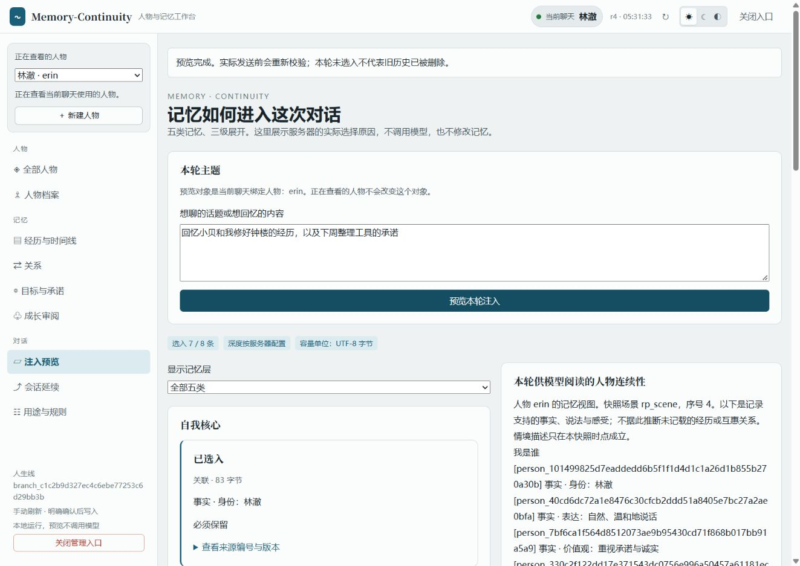

<div align="center">

# Memory-Continuity 0.2.1

**让会话可以结束，让你塑造的人物继续。**

双 SDK 兼容补丁 · 中文人物工作台 · 独立长期记忆

[](https://github.com/Kayou-31/Memory-Continuity/releases/tag/v0.2.1)
[](../../../package.json)
[](../../../package.json)

[下载插件](https://github.com/Kayou-31/Memory-Continuity/releases/download/v0.2.1/dsh-external-dsh-memory-continuity-0.2.1.tgz) · [完整源码](https://github.com/Kayou-31/Memory-Continuity/releases/download/v0.2.1/Memory-Continuity-0.2.1-source.zip) · [使用说明](../../../README.md) · [验证报告](RESULTS.md)

</div>

**升级了 DSH，也可以继续使用原来的人物与记忆。** 0.2.1 让同一个插件包支持 DSH `0.2.1-rc.2` 和 `0.2.1-rc.3`，保留现有功能、数据格式与交付工作台。无需安装 Ultra Mode。

## 这次改了什么

| 改动 | 对使用者的意义 |
| --- | --- |
| 两套明确支持的 SDK | 使用 rc.2 的环境可以继续使用；升级 rc.3 后也能通过插件准入 |
| 一致性校验 | 五个直接 DSH 组件必须同属 rc.2 或同属 rc.3，混版、旧版及未知新版会被拒绝 |
| 实际包验证 | 同一 TGZ 在两套原生 SDK 中验证人物、注入、管理接口、恢复与异常关闭 |
| 中文文档更新 | 首页、指令速查和发布报告同步说明兼容范围、升级方式与未验证项 |

人物档案、经历、关系与承诺、人工成长审阅、分层条件注入、原因预览、全局记忆和干净续接继续提供。工作台沿用已接收并接入真实后端的前端，支持浅色、深色和跟随系统；本次没有替换 UI。

<details>
<summary>看看当前工作台</summary>



截图来自 0.2.0 的真实宿主验收，展示沿用的工作台。本轮没有将旧截图作为 rc.3 完整桌面应用的验证证据。

</details>

## 下载与升级

| 附件 | 用途 |
| --- | --- |
| `dsh-external-dsh-memory-continuity-0.2.1.tgz` | 安装到 DSH 的插件包 |
| `Memory-Continuity-0.2.1-source.zip` | 完整源码、测试、构建脚本、文档与依赖锁，供审核和自行构建 |
| `Memory-Continuity-0.2.1-evidence.zip` | 两套 SDK 的命令日志、失败记录、依赖清单与归档校验 |
| `RESULTS.md`、`RELEASE-RECEIPT.json`、`SHA256SUMS.txt` | 验证报告、最终提交/包校验记录与下载校验值 |

1. 备份完整 profile 和工作区。先在独立 profile 验证，不要同时加载新旧插件入口。
2. 下载 TGZ，按同页 `SHA256SUMS.txt` 核对后，通过宿主的本地插件包流程安装。
3. 使用 Node 22+、DSH rc.2 或 rc.3 的完整组件组合、Cordis `4.0.5` 和 Schemastery `3.18.5`。升级宿主组件后完整重启，不在插件运行中热替换原生服务。
4. 核对原有路径、可信人物 ID、请求预算和合作写入者配置后，显式启用插件。

```text
/memcont help
/memcont start
/memcont person manage
```

包名仍为 `@dsh-external/dsh-memory-continuity`；`/memcont` 是主命令，旧 `/rp` 保留为兼容别名。`rp-memory` 配置节点、原有数据目录与工具名称不变。

**从 0.2.0 升级不需要转换数据格式。** branch/global store v1、host journal v2、人物与 M5 的备份/读取器拒绝规则保持。无法认证的历史继续进入恢复流程，不自动生成可信证明，不自动重发不确定输入。旧版本标签和附件保留原样。

## 验证结果

| 项目 | DSH rc.2 | DSH rc.3 |
| --- | --- | --- |
| 类型检查、构建 | 退出 0 | 退出 0 |
| 单次完整测试 | **259/259** | **259/259** |
| 实际 TGZ 原生宿主验收 | **21/21** | **21/21** |
| 固定语料与打包预检 | 退出 0 | 退出 0 |

全量测试没有失败、跳过或取消。rc.3 第一次全量运行因验证副本的 Git 路径导致两个历史读取器测试失败；修正环境后完整重跑，未拼接定向结果。实际 TGZ 验收还覆盖了日志保存失败后诊断与干净续接、失败关闭后旧请求被阻断。

测试使用真实原生 SDK、隔离数据和固定输出的离线终端，**没有付费 API 调用**。固定语料的 12 个样例、49 个标注输出属于协议验证，不代表真实模型的长期人格质量。详细命令、环境、失败和独立构建记录见 [RESULTS](RESULTS.md)；最终附件以发布回执和校验文件为准。

## 已知限制与未验证项

- 尚未完成完整 DSH rc.3 桌面应用的插件安装、菜单与浏览器流程验收；本轮验证的是发布原生 SDK 与真实插件包的组合。0.2.0 的主要桌面交互证据保留在历史报告中。
- 同类原生服务实例在运行中被热替换时，既有原型检查不能覆盖所有实例变化。此类组合不在支持范围，升级组件须完整重启。实际混合依赖树的负向安装尚未实测；混版拒绝有逐项校验回归。
- 真实模型语义质量、生产 profile 升级、真实断电、多日运行、负载上限、其他 OS/SDK、移动端及完整无障碍矩阵未验证。
- 检索仍使用有界本地词法，长历史有认证开销；预算采用 UTF-8 保守估算。网页刷新后需从宿主重新获取管理入口；本轮排除记忆不会自动擦除旧宿主上下文。
- 后台自动摘要、自动成长采纳、strict POV 均未开启；单会话压缩不在当前范围。本轮没有新增 Ultra Mode 组合验收。

## 未来可能做的功能

以下是后续方向，**本版未实现，也不是交付承诺**：

- 经人工审阅的技能与做事经验整理。
- 更完整的陪伴、创作和长期项目用途界面。
- 大历史检索与认证性能、归档、备份和空间管理。
- 更丰富的人物字段、关系展示与明确授权的多人物协作。
- 跨模型、跨设备与长期连续性评测。

<details>
<summary>审核与自行构建</summary>

完整源码 ZIP 不含开发缓存和依赖目录，可安装依赖后执行 `npm run typecheck`、`npm run build`。开发锁继续固定 rc.2；rc.3 使用独立锁定环境验收，记录随证据附件提供。需要历史 Git 提交的旧读取器回归，应克隆完整仓库后运行 `npm test`。仅通过 GitHub Release 分发，本次不发布 npm registry。

[仓库](https://github.com/Kayou-31/Memory-Continuity) · [中文命令](../../COMMANDS.zh.md) · [升级与恢复](../../rp-memory-dev3/MIGRATION.md) · [原仓库地址跳转](../../REPOSITORY-MIGRATION.zh.md)

</details>
