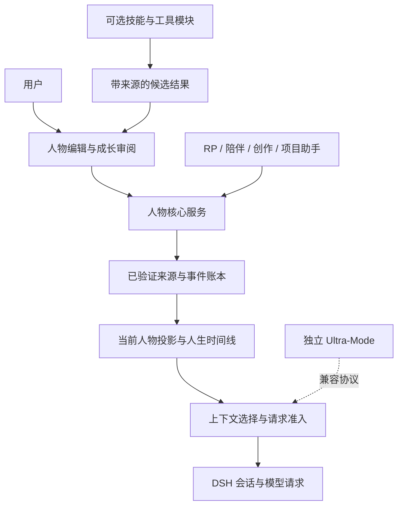

# Ultra-RP-Memory 人物核心与自有分支设计方案

日期：2026-10-23。状态：**用户已批准 M0、M1，验收后继续 M2；2026-10-23 开始实施，完成情况以 RESULTS.md 为准**。

代码依据：`3fa08e286b756299f76c603b492a2a82fcae7fdf`，`feature/agent-memory-20261022`。本方案承接 dev.3 的一致性、恢复、成长账本与 Ultra 可选适配，不替换既有实现和验收记录。

## 1. 产品目标与已经确定的边界

**让用户自己搭建、持续塑造一个完整的“人”，并让这个人的经历与选择在长期互动中延续。**

用户既能给人物设定起点，也能观察和确认他怎样从经历中改变。核心体验是：知道这个人是谁、记得发生过什么、理解关系为何变化、保留尚未实现的愿望与承诺，并能追溯每次重要改变。

用户已确定：

- Ultra-RP-Memory 独立可用，可以发展自己的多条功能和用途分支。
- Ultra-Mode 是平行独立项目，维持兼容即可。
- 人物是产品中心，项目、工具和任务是人物可以拥有的用途与能力。
- 保留现有技术架构、来源验证、fail-closed 和资源限制。
- 当前不启用后台自动摘要、strict POV、原生压缩、自动采纳和未经验证的迁移；不进行付费模型调用。

用户已批准按本方案串行实施，并明确接受新人物工作区要求新版读取、启用前备份。后续 M3/M4 仍为规划。

首个可交付闭环：**创建人物 → 开始互动 → 记录并确认经历 → 查看关系/目标变化 → 确认成长 → 跨会话继续 → 修订或分出另一条人生线**。

## 2. 路线选择

| 路线 | 优点 | 成本与取舍 | 建议 |
|---|---|---|---|
| 一个不断扩大的总插件 | 初始入口统一，少量功能起步快 | 人格、工具、宿主和多种用途互相耦合，故障与配置难隔离 | 不作为长期结构 |
| 每个用途复制一个 Git 分叉 | 可以快速独立改动界面与行为 | 一致性、权限、迁移修复需要重复同步，易产生数据分歧 | 仅用于短期实验，不作为正式分支体系 |
| 共享人物核心＋可选模块/用途配置 | 数据与安全协议一致，用途可独立演进，核心可单独使用 | 需要定义稳定的模块输入、结果认证与生命周期 | **推荐** |

初期在现有独立 npm 包内按目录隔离模块，保持一个正式发布入口。只有模块确实需要独立依赖、发布节奏或维护者时再拆子包；不提前把工程变成一组微服务。Git 分支继续用于开发与实验。

## 3. 三种“分支”分开处理

| 名称 | 含义 | 对记忆的影响 |
|---|---|---|
| 用途分支（experience mode） | RP、陪伴、创作、项目助手等功能和界面组合 | 默认共享所选人物及人生线，切换用途不复制记忆、不改变事实 |
| 人生线（life branch） | 某个时点之后走向不同的经历与选择 | 使用现有固定前缀 branch；新事实互不影响，不自动合并 |
| 开发分支（Git branch） | 开发不同版本或实验 | 不作为用户的记忆隔离工具 |

人物身份使用稳定 personId。首期令 personId 等于受信任的 entityId，唯一身份范围为 workspaceId＋campaignId＋entityId，禁止两张独立人物卡映射同一实体。相同 personId 在不同人生线上的当前状态可以不同；创建独立人物副本需要新的受信任 entityId。人物模板是可复制的初始设定；实例经历不会反向写入模板，也不会自动跨 workspace 同步。

首期允许一个工作区保存多个受信任人物，一个宿主会话只绑定一个主要人物；多 Agent 同时行动、自动社会模拟与跨工作区共享另行设计。

## 4. 总体架构

人物核心管理确认过的设定、经历和成长。模块只能获得当前授权所允许的视图，提交有来源的候选；只有可信用户操作可以采纳。模型生成的正文先作为观察到的对话材料，不自动成为世界事实或人格变化。

模块停用后，主体仍能读取既有确认记录。人物核心所需的格式定义、重放规则和来源解释不能依赖某个可卸载模块；模块专有扩展只作为带命名空间的附件，不自动进入人格投影。

## 5. “完整的人”包含哪些内容

| 层面 | 内容 | 变化方式 |
|---|---|---|
| 身份与背景 | 姓名、身份、自我介绍、出身、重要历史 | 初始定义；修正与人生变化分开 |
| 人格倾向 | 谨慎、好奇、耐心、表达直接程度等带情境描述的倾向 | 有原因的成长，保留例外与矛盾 |
| 价值观与边界 | 在意什么、优先考虑什么、明确不愿做什么 | 稳定字段优先，重大变化逐项确认 |
| 表达习惯 | 语言、语气、称呼、叙述方式 | 可编辑；用途只能在允许范围内调整 |
| 个人经历 | 事件、参与者、时间、结果、来源 | 采纳后进入人生线，原始证据可回查 |
| 主观认知 | 已知、相信、怀疑、未确认的判断 | 区分世界事实与个人立场，冲突可保留 |
| 人际关系 | 有方向的信任、亲近、紧张、债务、承诺等 | 对象、原因事件和前驱明确；不推导对方感受 |
| 愿望与目标 | 想成为怎样的人、长期目标、近期打算、承诺 | 目标与承诺沿现有生命周期演进 |
| 当前感受 | 当前场景的心情、压力、犹豫、关注点 | 有效期明确；不自动改写长期人格 |
| 技能与经验 | 做过什么、结果如何、在哪些条件下可复现 | 记录能力证据；次数和自述不自动等于熟练 |
| 人生阶段 | 用户定义的阶段、转折点、重要里程碑 | 手动推进与关联事件；不按电脑日期自动长大 |

人格描述以文本、适用情境和例外为主。可选的量表仅表示用户设定的倾向强度，不强制给所有人物打分，也不把“信任 80”解释为心理测量结果。

### 5.1 字段控制方式

每个字段有独立的控制方式，避免一项锁定影响整个人物：

- **稳定设定**：只能通过用户明确修订改变；普通经历不能覆盖。
- **可成长设定**：需要已接受经历、当前字段前驱、变化理由和用户采纳。
- **情境状态**：仅在指定场景或接受序号区间内生效；过期从当前上下文移除，原事件留在时间线。

改变字段控制方式本身也需要用户确认并形成记录。模型及能力模块不能自行解除锁定。未填字段显示“未设定”，不能用模型猜测补成确定事实。

初始人物定义可以不依赖先前经历，因为它是用户创建起点的明确陈述；创建完成后的成长必须带原因。普通编辑、正常成长、纠正错误、隐私删除应显示为四种不同操作。

具体规则：普通编辑追加一条由用户签发的 `edit` 人物事件，引用当前字段前驱，只改变今后的当前值，不把前驱或其支持的历史标记为无效。正常 `grow` 需要已接受原因经历，且只能作用于可成长字段。策略切换使用独立 `set-policy` 操作，也沿同一字段前驱链追加，保留值与前史；既有候选须重新校验前驱。Retcon才显式将错误事件及其真实依赖闭包失效；删除沿隐私协议处理。

新增 `edit/set-policy` 权限只属于可信用户确认路径。它们不复用“绕过 locked canon 的普通 growth”，也不把改名伪装成Retcon；普通模块和模型候选不得提交这两种操作。人物稳定字段使用新人物协议的字段控制策略，原有 locked canon 仍遵守原来的显式Retcon规则，不被新编辑入口解锁。

### 5.2 事实、记忆与主观认识

原始对话、确认事件、个人信念和当前人物投影分别保留。人物说“他很信任我”只证明他说过这句话；采纳成他的信念也不证明对方真实信任他。

关系有方向，例如 A 信任 B，不自动写成 B 信任 A。认知矛盾进入“待处理”，不按最后时间戳决定胜者。记忆淡化首先表现为检索优先级下降；删除原始证据使用独立的明确删除流程。

当前宿主仅验证 narrator 模式，strict POV 仍关闭。首期的个人认知字段用于明确语义，**不承诺对完整宿主历史实现角色秘密隔离**；要求强隔离的用途模块不能启用，返回 capability_missing。

## 6. 用户交互与页面

首期建议提供一个离线人物编辑器，生成严格版本化 JSON 草稿，通过可信命令导入。它不直接访问运行中的 profile，也不携带写库权限。先交付可独立打开的本地编辑界面，后续确认 DSH 原生面板接口后再接入；不假定 SDK 已具备未验证的 UI 能力。

| 视图 | 用户能做什么 | 必须展示的信息 |
|---|---|---|
| 人物首页 | 查看当前人物、主要关系、愿望、阶段 | 当前人生线、已确认/待确认、状态是否过期 |
| 人物编辑 | 定义身份、背景、表达、价值观、倾向与边界 | 稳定/可成长/情境、当前值、修改预览 |
| 人生时间线 | 按阶段查看事件，展开来源与影响 | 真实记录时间与剧情时间分开；被修订事件保留标识 |
| 关系与目标 | 查看关系变化、承诺与目标进度 | 方向、原因、前驱、未解决冲突 |
| 成长待确认 | 集中检查候选、采纳或拒绝 | 旧值→新值、理由、证据、影响对象/人生线 |
| 用途与能力 | 选择用途、启停模块 | 所需权限、兼容状态、数据输入/输出范围 |

首期编辑器负责草稿与导入预览；时间线和成长审阅先由宿主只读命令/导出视图提供。第二阶段才接带权限的实时页面，不把静态编辑器冒充在线管理界面。

### 6.1 创建人物流程

1. 用户选择已有受信任 entityId，或在可信配置中注册新 entityId 后重新加载。当前 entityIds 来自启动配置；模型、草稿导入和普通模块不能顺便扩大实体权限。
2. 选择空白人物或模板，填写基本身份，再按需补背景、倾向、价值观、表达和初始关系。
3. 编辑器生成草稿，不绑定权限、文件路径或运行时 sessionId。宿主导入时由当前授权上下文绑定人物和人生线。
4. 宿主验证格式、所有实体引用、字段限制、容量与预期版本，展示即将创建的字段和关系。
5. 用户确认后一次原子提交初始定义；失败不留下半个人物，不自动覆盖同名 personId。
6. 首次开始互动时，模型收到当前有效的人物定义和必要来源；未设定内容保持未设定。

模板中的经历必须标明是用户认可的初始背景。不得把模板故事伪装成真实宿主已经发生的工具执行结果。

### 6.2 一次成长流程

例如人物“林澈”初始谨慎、不轻易信任他人，在某次共同救援后与“阿岚”的关系发生变化：

1. 对话被保存为原始来源，用户确认救援这一经历。
2. 用户或后续显式请求的候选生成器提出：“对阿岚的信任由保留变为愿意托付”，列出救援事件、当前关系前驱和理由。
3. 用户可以修改、采纳或拒绝。稳定价值观不会因为关系候选顺便改变。
4. 采纳后，旧关系阶段仍可查询；新会话能看到当前关系及形成原因。
5. 如果救援后来被 Retcon，依赖它的关系变化失效；另一人生线和无关关系不受影响。

同一次审阅可选择多条候选批量确认，但所有候选基于同一初始版本，按确定依赖顺序预演，整体提交；存在冲突时整批拒绝并显示原因。不能把顺序不同的用户勾选变成不同结果。

### 6.3 导入确认与会话绑定

拟新增可信宿主命令族 `/rp person`，覆盖草稿预览、确认、查看和绑定；具体参数在实施计划中固定。用户先建立或选择已授权人生线，再预览人物草稿，确认创建后绑定主要人物。普通模型工具继续只读，不能调用人物创建或确认入口。

预览产生宿主签发的不可伪造句柄，绑定完整草稿哈希、编译后的操作、完整 InputFence、人物ID、授权身份和能力版本。确认必须指向同一份预览内容；内容或 fence 改变返回 stale_input，要求重新预览。草稿里的布尔确认字段、来源ID或所谓管理员字段不能替代用户确认。

确认用稳定操作键及内容摘要实现幂等。已经提交但回执丢失时先补 seal，再返回原效果，不再次创建人物。进程重启后未确认的预览句柄失效，重新预览；不把它自动转成已采纳。

首期字段沿当前分支的单一 audience 存储，不在同一人物草稿内混合不同私密级别。需要字段级秘密隔离时明确不支持，不能仅靠编辑器隐藏字段声称完成访问隔离。

空原生历史的会话可以绑定人物。有历史且更换主要人物/人生线或改变影响上下文的用途时，先建立干净 root，再进入新上下文；不原地给旧人物历史换标签。人物绑定与对应证明写入journal v2的显式可选扩展，旧reader遇未知字段仍拒绝；原来的无人物模式可继续按旧规则运行。出现人物历史但缺绑定证明时进入recovery-only，不从当前人物卡倒填认证。

## 7. 数据模型与持久化

### 7.1 逻辑模型

以下是设计接口，不是现有 SDK 的声明：

| 对象 | 关键字段 | 持久化职责 |
|---|---|---|
| PersonIdentity | personId/entityId、displayName、创建来源 | 关联受信任实体；显示名变化不改变身份 |
| PersonField | fieldId、类型、值、控制方式、适用情境 | 每字段独立版本与前驱，不覆盖整张大卡片 |
| PersonChange | 操作、previousEventId、causeEventIds、理由、来源 | 追加式事件，区别初始化/成长/修正 |
| PersonView | 人物、branchId、完整 InputFence、字段及支持事件 | 从已验证账本推导，可重建；不成为第二份事实源 |
| GrowthProposal | 基准 fence、字段变更、证据、前驱、状态 | 未采纳正文放可删除存储，禁止写入不可删除日志正文 |
| ModeSelection | modeId、版本、当前 session/branch 绑定 | 只改变用途配置，不带事实写权限 |
| ModuleReceipt | moduleId、实际返回的记录/结果摘要、原始证明 | 认证执行结果；模块自填 success 不是证明 |

人物模板不携带可信来源授权、真实工具回执或可复用 capability。导入模板创建新实例时，按新的用户控制来源建立记录，关系引用需显式映射；首期不导入整段外部人生历史。

### 7.2 复用现有 v1，而非追加一套可变人物库

现有 state key 是白名单，不能直接写 `personality` 等任意新键。建议在既有 identity/background/voice/rule payload 中封装 `person-core/v1` 的字段值，并在同一事务中写入明确语义 marker。字段投影键由经过认证的 fieldId 派生，稳定字段按字段锁定。

这与已有 `agent-memory/v1` 共存，须统一语义识别入口。只有合法 ledger marker 才启用人物协议，普通旧 JSON 的同名字段永远不触发新语义。既有经历、关系、目标格式继续使用；不复制到另一套人物事实表。

新增人物语义必须在 store 提交与冷读取两侧同时校验。字段标记只可引用同事务新事件；前驱与原因依赖沿现有 dependencyIds 保存。只保留直接来源，祖先沿依赖边追溯，避免再引入线性增长的 sources 数组。

**新旧人物状态共存规则：** 在同一人生线创建人物前，若该entity已有未标记为人物协议且仍有效的 identity/background/voice/rule 状态，首期拒绝初始化并列出冲突记录。用户可选择新的受信任entity；旧人物转换另行设计，不自动重解释或抹去旧状态。既有关系/目标可以继续指向该entity，因为复用原格式，不形成第二份身份真相。人物初始化完成后，store对该entity这四个保留键的所有新增写入要求person-core标记；旧 `/rp agent state` 和直接canonical路径也必须拒绝未标记写入，不能只在UI上限制。创建前的固定人生线按自己的原始语义读取，不反向改写。

**读取能力屏障：** 旧v1数据仍由新reader兼容读取，global格式不变。启用人物协议建议增加一个显式的v1事务扩展，而非宣称存储字节格式完全不变：在首次人物初始化事务的哈希覆盖对象中写入 `requiredCapabilities:["rp.person-core/v1"]`，与人物定义同事务发布并封存。能力集合在重放中单调累加，不允许通过后续事务移除。该扩展同时纳入效果哈希、容量与幂等检查；人物写入没有对应能力标识则拒绝。

当前旧reader对事务未知字段严格拒绝（`store.ts` 的transaction对象校验），因此该屏障会使旧reader拒绝**整个对应workspace账本**，包括新建的无人物会话和同workspace其他分支；不会影响其他workspace及global store。新reader遇未知requiredCapabilities也拒绝且保留原件。这个范围由目前workspace共享事务链决定，不能假称仅阻止一个人物分支。

这是用户于 2026-10-23 明确接受的兼容策略：保留schemaVersion 1和旧数据读取，并显式扩展读取能力，**不支持新人物工作区由旧writer继续访问**。实施前必须用真实旧源码验证拒绝，并验证原有workspace读写不变；若将“v1兼容”限定为旧程序也可继续访问新数据，则本方案的人物持久化部分必须重新设计，不能静默采用该扩展。首次写入前备份，降级恢复整份启用前workspace/profile对应备份；禁止删字段或删除事务来降级。host journal保持v2可选扩展，不拿journal拒绝替代存储层屏障。

### 7.3 建议首期输入边界

下列值是可调整的产品上限建议，不是吞吐保证；实施前纳入定向测试和体积验证：

- 人物草稿序列化 UTF-8 最大 **64 KiB**，含模板元数据。
- 单人物最多 **128 个结构化字段**，单字段文本最多 **2,048 个 UTF-16 code units**；最终整体大小仍由64 KiB约束。
- 初始关系最多 **32 条**、初始目标最多 **16 条**；展开后的整个初始事务不得超过现有256事件上限。
- 首期批量采纳最多 **16 条候选**；单条原因事件最多32个，沿用当前成长约束。
- 用户字段使用注册的类型/fieldId；自由扩展进入命名空间，默认不注入模型。
- 任一边界超出即拒绝并指出字段，不静默截断；请求预算与现有事务 envelope 上限继续最终兜底。

初始定义引用已知对象即可建立初始关系，但既有关系格式要求至少一个触发事件。创建时先编译一条由用户控制来源支持的“用户定义人物起点” occurrence，再让初始关系/目标引用它，按依赖顺序在同一事务提交。该起点明确属于初始设定，不声称曾有真实宿主行动；后续成长仍要求已确认的实际剧情/互动经历。多个初始字段应作为一次 canonical commit 提交；目标仍按已有 active/0 起点规则创建。

### 7.4 修订、删除、备份

普通成长保留前史，修正使用 Retcon，删除继续走先阻断后物理清理流程。人物投影、候选、搜索缓存、导出副本的来源依赖均需登记；删除某条私人来源后不得从另一个人物缓存重新注入。

用户已另存到外部的模板/导出/备份不在插件可直接保证的删除范围内，结果必须列出这些副本。不得为恢复方便把人物正文再复制到不可删除审计字段。

## 8. 检索、上下文与性能设计

### 8.1 先筛选，再排序，再复核

顺序固定为：授权与可见性 → 人生线有效性 → fence 一致的记录视图 → 人物/关系/目标匹配 → 去重排序 → 预算裁剪 → 最终版本与回执验证。

首期可用确定性排序因素：与当前输入的词项相关度、当前参与人物、活跃目标、显式里程碑、近期性。因子和版本记录在诊断中，用固定语料比较后再确定权重；不在设计阶段声称某一组权重最优。重复提及不自动提高人物事实的真实性。

近期经历和早期关键转折分别保留候选名额，避免所有名额都被近期重复对话占据。只从当前授权集合选 ID，缓存或外部排序器不得补写事实。

### 8.2 人物上下文

始终保留人物身份、稳定边界、当前冲突提示、当前适用目标及必要关系；可选加入与本次互动有关的经历、阶段摘要和技能证据。完整的字段正文仍可通过只读检索读取，不能假定128个字段都能放进每次请求。

人物简介必须来自用户明确填写或用户采纳的摘要；不在后台悄悄生成一份替代全文的“人格摘要”。上下文展示当前值与来源 ID，不把所有前史重复塞入提示词。

当前包最多注入8条可选经历，先保留此上限与完整请求预算检查，再用评测决定是否调整。必需内容也超预算时明确拒绝，展示是哪些部分占用预算；不静默移除稳定边界。

绑定人物、人生线、字段投影和模块能力版本都进入请求证明。角色/模式改变只要影响认证上下文，就先检查历史兼容性，必要时要求干净续接；UI可提示并引导，但不能绕过旧历史证明。

### 8.3 性能优先顺序

已有260阶段验证约640秒，包含每步写入与重新读取；该结果只说明该路径可完成且成本高，不是单请求延迟。建议在大量扩充字段前先做：

1. **一次操作内的已验证读取视图**：events/summaries/projection 共用同一份已验证加载，读前读后校验不减弱；不跨权限、fence、删除 generation 复用。
2. **有界缓存和分页游标**：以完整 fence/授权身份标识视图，记录容量与淘汰；旧分页可明确过期，不能静默换结果集合。
3. **可重建词项索引**：索引只给候选 ID，再从权威 store 验证；索引缺失可回退，损坏不可当事实，删除先撤销可用性再清理。
4. **长期分段存储独立立项**：现有 envelope/journal 限制保留。后续若需要更长人生，先设计追加分段与校验链、冷恢复和迁移，再谈容量；本方案不授权截断事务或偷偷升级存储。

M0测量100/260阶段相同真实存储夹具的总耗时、分项读写/验证耗时、峰值工作集和字节数，必要时重复三次记录中位数及范围；不把三次样本称为可信p95。以未优化版本同机串行对照，目标为减少重复读取并无显著回归，不先承诺未测的速度倍数。

## 9. 自有模块与 Ultra-Mode 兼容

### 9.1 模块契约

模块声明 id、版本、兼容核心版本、请求能力、输出类型、用途适配和关闭行为。宿主分配短生命周期 capability；普通配置字符串和模块自报结果不具有授权效力。

初期允许的核心能力：读取已授权人物视图、读取有限原始记录、提交候选。真实工具执行另由宿主权限控制，不因安装一个人物模块获得。

模块返回值同时携带已认证调用身份、实际输出摘要、来源记录与 revision、模块版本和请求 fence。核心验证当时结果，不能用查询结束后的新状态替旧结果背书。没有宿主执行证明的结果只能作为未认证材料，不可自动作为“我确实做成了”的经历。

模块装入或卸载不能执行任意历史迁移，不能注册绕过根级门禁的模型调用。发生冲突、未知协议或撤销权限时关闭相关能力；已经确认的人物数据仍由核心解释。

所有同进程插件都属于可信宿主代码；接口限制不是对恶意 npm 插件的操作系统沙箱。首期不建立任意第三方插件市场或不可信代码加载器。

### 9.2 用途配置

| 用途 | 主要体验 | 允许增加的能力 |
|---|---|---|
| RP | 世界、人物关系、剧情时间与不同人生线 | 场景规则、剧情模板、人工事件采纳 |
| 陪伴 | 日常互动、共同经历、偏好和长期约定 | 日常记录与回忆呈现；保持用户控制 |
| 创作 | 角色一致性、设定、人物弧线 | 人物/关系查看、设定冲突提示 |
| 项目助手 | 以同一人物身份持续做事 | 项目经验、任务进展、受控工具结果候选 |

先完成一个“通用人物＋RP”闭环，其他用途通过配置及模块后续加入；不会一次实现四套完整产品。

### 9.3 Ultra-Mode

保持当前 sessionMemoryPolicy/v1、RP owner 和工程隔离。兼容服务存在时可选择当前 ultra-rp/v1 纯排序适配，无 Ultra 时所有核心功能可用。未知/混版服务 fail-closed，不仅凭包名启用。

不要求调用 Ultra 的工程归档/压缩器，不把工程历史拼入人物上下文。未来若提供项目能力模块，它属于 Ultra-RP-Memory 自有用途；与 Ultra-Mode 的兼容单独测试和维护。

验收覆盖无 Ultra、关闭适配、有兼容 Ultra 双加载顺序、服务失效/撤销、Memory/Decision 共存。未验证版本不能宣称兼容。

## 10. 现有代码映射与建议新增边界

| 部分 | 可复用 | 新增/调整建议 |
|---|---|---|
| 来源、事务、依赖、删除 | `src/rp/store.ts`、`canonical.ts`、`types.ts` | 一次操作读取视图；人物语义 marker 和字段依赖验证 |
| 现有成长 | `agent-memory.ts`、`growth-format.ts`、`reducer.ts` | 与人物字段协议共用明确语义注册；不能识别普通JSON前缀来猜协议 |
| 人物定义与草稿 | 当前仅 identity/voice/background 及配置 entityIds | 建议 `src/rp/person/{types,schema,service,projection}.ts`，严格字段与原子初始化 |
| 人物编辑 | 尚无专用界面 | 建议独立 `ui/person-editor/`，仅产生/读取受限草稿，不直接写profile |
| 成长审阅 | 既有人工 candidate/summary 流程 | 独立人物变更候选，不强行当成 summary；复用可删除payload与控制凭证 |
| 检索与上下文 | `retrieval.ts`、`lexical.ts`、`packet.ts`、`packet-proof.ts` | 人物字段和情境投影、可解释选择、读取视图复用 |
| 用途与能力 | 当前只有可选optimizer | 建议 `src/rp/modules/{contract,registry}.ts` 与 `modes/`；先只做内置可信模块 |
| 宿主 | `rp-plugin.ts`、`host-journal.ts`、`admission.ts` | 人物/用途绑定、命令适配、恢复与版本验证；不无界扩大单文件 |

本表是职责划分，精确函数签名与逐文件测试工单留到设计确认后的实施计划。不同协议的语义识别必须集中管理，避免多个 WeakSet/marker 分支各自遗漏克隆、冷读或固定分支路径。

## 11. 分阶段交付与验收

| 阶段 | 可独立交付的结果 | 必须证明 |
|---|---|---|
| M0：性能与读取视图 | 同一操作复用已验证视图，给出基准报告 | 与现有结果一致；并发删除/Retcon仍拒绝旧内容；记录同机前后耗时与内存 |
| M1：人物创建闭环 | 人物字段、离线编辑器、导入预览、原子创建、人物绑定 | 用户无需手写内部record ID可创建；旧JSON不误解释；未知实体/超限/重放导入安全拒绝；冷恢复及实际请求包含正确人物 |
| M2：可解释成长 | 字段稳定/成长/情境策略、审阅队列、批量确认、时间线 | 无依据成长拒绝；稳定字段不被覆盖；批量顺序无关；删除祖先后重建；不同人生线隔离 |
| M3：自有分支框架 | 内置用途配置、模块能力声明、启停与结果候选 | 模块关闭后核心可读；未认证结果不入事实；角色/模式切换不会继续发送失效历史 |
| M4：长期体验评测 | 固定人物故事、同输入对照、规则与模型质量分开报告 | 初期只跑离线规则/真实宿主；真实模型另行授权和报告，不把fixture当语义成绩 |
| 后续独立项目 | 历史分段/容量迁移、技能成长、多人物社会、完整实时UI | 分别出设计与迁移/能力验收，不在本次设计里隐式开启 |

M1先支持身份、背景、表达、价值观与边界字段；人格成长、情境感受与阶段演化在M2补齐。M0与M1按现有一个执行者串行实施，不拆并发开发。最多一个只读审阅者，不递归代理；同一时刻一个构建/安装/重型测试，连续两次同错先诊断。

每阶段先失败回归，再实现，再定向验证；最终独立运行 `npm run typecheck`、`npm run build`、`npm test`、`npm run evaluate:fixture`、`npm pack --dry-run`，以及实际包的精确SDK验收。只改设计文档时不运行这些构建命令，也不引用旧测试为新增设计背书。

## 12. 固定验收故事

以“林澈—阿岚—钟楼救援”作为贯穿夹具，保留人工设定的预期值和证据片段：

1. 创建谨慎、重视守诺的人物，跨干净续接保持身份与表达。
2. 某次随口自夸不会自动变成技能熟练或人格提升。
3. 确认救援后，允许关系候选，采纳前不改变关系。
4. 信任变化只影响林澈→阿岚，不写入反向关系。
5. 稳定边界在模板、对话、模块输出的冲突指令下保持原值。
6. 承诺暂停、完成与放弃遵守既有生命周期，过去的承诺可以查证。
7. Retcon救援，依赖它的成长失效；独立事件和兄弟人生线保持不变。
8. 删除私人来源后，缓存、候选、索引和新packet均不能取回它。
9. 另一用途的切换改变界面和可用能力，人物身份及当前人生线保持明确。
10. 模块失败/卸载和Ultra关闭后，人物核心仍可单独读取与继续。
11. 人物字段变化后，旧认证上下文不能被继续发送；干净续接可恢复有效人物。
12. 存储/预算达到上限时保留已写数据，明确拒绝新增，不自动删前史或启动压缩。

补充兼容与编辑验收：改名和策略切换保留旧事件及其支持的经历；旧身份存在时初始化明确拒绝；人物创建后旧写入口不能改保留字段；真实旧reader无法经新会话访问启用人物协议的workspace，其他未启用workspace保持原行为；能力事务连续seal故障后仍可冷恢复且不重复初始化。

规则正确性、离线合成宿主结果、真实模型语义结果分别报告。以后开展真实模型评测时，同时记录人物一致性、事实支持、关系方向、拒绝越权、长期回忆及成本，不只统计答对数量。

## 13. 需要用户审阅的关键取舍

- 首期人物编辑器采用离线草稿＋宿主预览导入；实时管理面板后置。
- 默认稳定字段由用户修改，可成长字段采用集中审阅；模型只提出候选。
- 产品用途通过共享核心和模块组织，人生线仍使用既有记忆branch隔离。
- 先交付通用人物＋RP闭环，再扩展陪伴、创作和项目助手。
- 先解决重复读取，再增加大量人物状态；无限历史容量不作为当前版本承诺。
- 人物协议采用显式读取能力扩展后，旧版本将拒绝对应整个workspace；启用前备份，回退恢复备份。此项已获用户批准；实际落地状态与兼容验证见 RESULTS.md。

以上选择均可在实施前调整。本轮只交付设计文档，不新增生产代码、依赖、后台功能或发布产物。

设计检查记录：一个只读审阅者首次指出普通编辑/Retcon、新旧身份共存、最低reader能力三个缺口；本稿已分别补入字段操作规则、唯一身份及旧写入口拒绝、workspace级读取能力屏障。窄审确认这些裁决足够进入实施计划，没有新增必须由产品决定的矛盾。该结论是静态设计检查，不代表新协议、界面或旧reader拒绝已通过运行验证。
